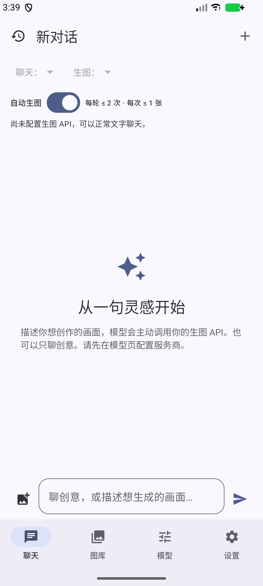
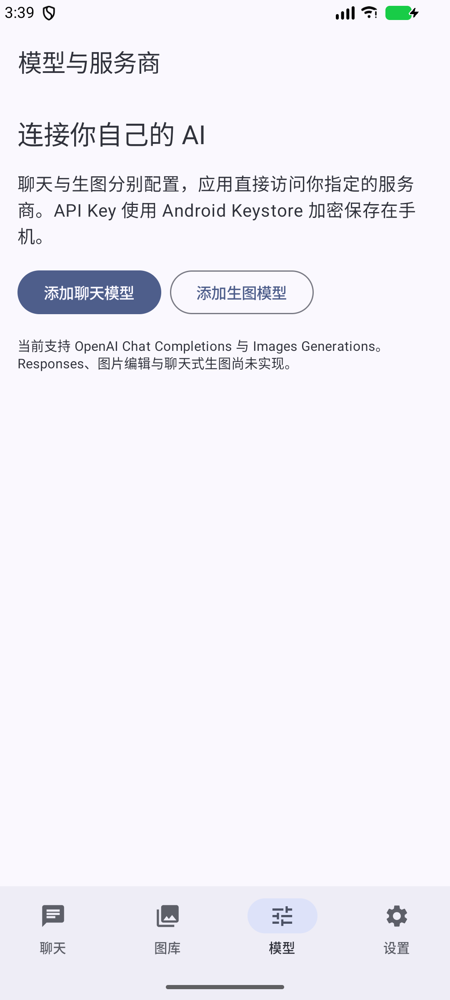

# MuseChat AI

**让聊天模型主动调用你自己的生图 API。** 原生 Android AI Agent 客户端，聊天与图片生成服务商可以完全独立配置，无需开发者服务器或平台账号。

> 首个预览版，支持文生图。核心协议链路使用模拟 API 自动测试；具体第三方服务商和真实手机仍需实际验证。图片编辑、参考图上传和人物一致性保证尚未实现。

## 界面

以下为实际运行的 Android 模拟器截图，不是效果图。

 

## 工作方式

输入“生成一张白发蓝瞳少女在雨中撑伞的插画”，聊天模型可以返回真正的原生 tool_calls。客户端验证 generate_image 参数，调用独立图片 API，保存原图，在当前聊天中展示，再把对应 tool_call_id 的结果反馈给聊天模型。

普通创意讨论由模型正常回复；没有关键词触发、JSON 文本假调用、模拟图片或预设回复。

## 已实现

- Kotlin、Jetpack Compose、Material 3，中文界面、浅色/深色与动态配色。
- 多个聊天和生图配置；独立 Base URL、模型 ID、凭据与模型列表查询。
- OpenAI 风格 Chat Completions，普通响应、SSE 文本与多工具分片合并。
- 真正的 Agent 工具循环、动态 Schema、严格校验、逐个工具结果回传。
- 自动执行、执行前确认、禁用工具；默认每轮 2 次、每次 1 张。
- OpenAI Images Generations，URL/Base64，以及明确字段映射的自定义响应适配器。
- Room 聊天/工具记录/图片元数据，DataStore 偏好，Keystore + AES-GCM 凭据保护。
- 原图保存、聊天图片卡片、图库、缩放预览、分享、相册保存、提示词复制与再次生成。
- 新建/重命名/删除历史、Markdown/代码块、消息复制、取消请求与重新发送。
- API 连接、工具能力检查和用户主动确认的真实生图测试。
- 网络错误、限额、取消与进程中断恢复，不自动重试付费生图。

## 安装

在 [Releases](https://github.com/zhuquan7237/musechat-ai/releases) 下载 APK，允许对应安装来源安装，然后在“模型”页配置服务商。最低 Android 8.0（API 26）。

预览包使用 **Debug 签名**，不是商店正式发行包。不同开发机或 CI 的 Debug 证书可能不同，不能保证覆盖安装；正式长期更新应使用自己的固定 Release 签名密钥。卸载会删除私有数据，请先保存重要图片到相册。

## 快速开始

1. 添加聊天配置，填写名称、HTTPS Base URL、模型 ID 与 API Key。
2. 添加独立生图配置，填写对应地址和密钥、实际支持的尺寸、数量和可选高级参数。
3. 测试聊天与原生工具能力。模型列表失败也可以手填模型 ID。
4. 回到聊天页选择两份配置，用自然语言描述想生成的图片。

聊天和生图都可能产生服务商费用。开启“执行前确认”可逐次检查参数。取消本地任务不保证远程停止计费。详见 [CONFIGURATION.md](CONFIGURATION.md)。

## 构建

Android Studio 打开仓库根目录。需要 JDK 17、SDK Platform 36 / Build Tools 35.0.0；Gradle Wrapper 已包含。Windows 建议使用纯英文项目路径。

Windows：

~~~powershell
./gradlew.bat :app:assembleDebug :app:testDebugUnitTest :app:lintDebug
~~~

macOS / Linux：

~~~bash
./gradlew :app:assembleDebug :app:testDebugUnitTest :app:lintDebug
~~~

APK：app/build/outputs/apk/debug/app-debug.apk。测试报告：app/build/reports/tests/testDebugUnitTest/index.html。

设备/模拟器测试：./gradlew :app:connectedDebugAndroidTest。

GitHub Actions 自动执行单元测试、Lint、APK 构建，产物位于 [Actions](https://github.com/zhuquan7237/musechat-ai/actions) 的 Artifacts。设备验证记录见 [VALIDATION.md](VALIDATION.md)。

### 正式签名

设置 SIGNING_STORE_FILE、SIGNING_STORE_PASSWORD、SIGNING_KEY_ALIAS、SIGNING_KEY_PASSWORD 后运行 :app:assembleRelease。未配置签名时 Release 为未签名 APK，不可直接安装。仓库不包含签名密钥或 API Key。

可选 Actions 手动签名流程见 [CONFIGURATION.md](CONFIGURATION.md)。

## 架构与边界

[ARCHITECTURE.md](ARCHITECTURE.md) 解释工具循环、取消与持久化；[PRIVACY.md](PRIVACY.md) 说明数据流向。

暂不支持 Responses、图片编辑、参考图、聊天式生图、MCP、任务队列和数据导入导出。生成质量、尺寸、工具能力和费用由服务商决定。没有前台服务：进程活着时任务可继续，系统终止进程后不重发任务。没有自动上下文压缩，长对话可能触及服务商限制。

欢迎提交 Issue 和 PR，见 [CONTRIBUTING.md](CONTRIBUTING.md) 与 [SECURITY.md](SECURITY.md)。

MIT License · Copyright 2026 zhuquan7237
